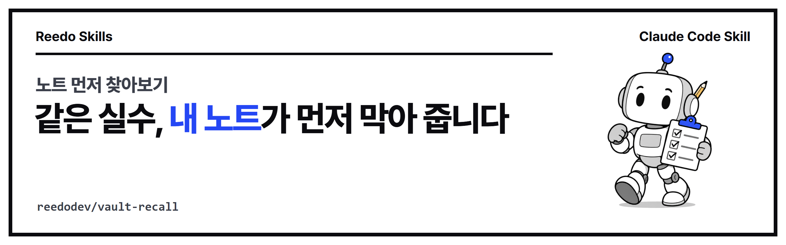

<p align="center"></p>

<p align="center">
<a href="https://github.com/reedodev/vault-recall/actions/workflows/test.yml"></a>


</p>

# 노트 먼저 찾아보기 (vault-recall)

일을 시작하기 전에 옵시디언(마크다운) 보관함에서 이번 작업과 관련된 지난 교훈·실패·해결 기록을 찾아 먼저 읽게 합니다. 한국어는 두 글자 단위로 비교해 조사가 달라도 찾고, 확인된 노트와 최근 노트에 점수를 더 줍니다.

## 처음 쓰시는 분을 위한 안내

### 이 스킬이 해결하는 문제

노트에 "이렇게 하면 실패한다", "이 방법으로 해결했다"를 적어 두어도 막상 같은 일을 시작할 때는 떠올리지 못해 같은 실수를 반복하기 쉽습니다. 이 스킬은 작업을 시작하기 전에 내 노트 폴더에서 관련된 지난 교훈을 먼저 찾아 에이전트가 읽게 합니다.

- 상황 1: 유튜브에 영상을 올리기 전에 "고정 댓글은 예약 공개 뒤에 단다" 같은 내 지난 메모를 먼저 꺼내 보고 싶을 때
- 상황 2: 노트가 수천 개라서 어디에 적었는지 기억나지 않지만, 비슷한 작업을 한 적이 있을 때

### 용어 풀이

- **터미널**: 명령을 글자로 입력하는 창입니다. Windows는 PowerShell 또는 Windows Terminal, Mac은 터미널 앱입니다.
- **Claude Code**: 터미널에서 쓰는 AI 코딩 에이전트(사용자 대신 파일을 읽고 명령을 실행해 주는 AI)입니다.
- **스킬**: 에이전트가 읽고 그대로 따르는 사용 설명서(SKILL.md)와 실행 파일을 묶은 폴더입니다.
- **보관함(vault)**: 옵시디언에서 노트(.md 파일)를 모아 둔 폴더입니다. 옵시디언을 쓰지 않아도 `.md` 파일이 든 폴더면 됩니다.
- **머리말(front matter)**: 노트 맨 위에 `---`로 감싼 `status`, `tags` 같은 정보 칸입니다. 없어도 검색됩니다.

### 준비 확인

이 스킬은 Node.js(자바스크립트를 실행하는 프로그램) 18 이상과 `.md` 노트가 든 폴더만 있으면 됩니다.

```bash
node -v
```

`v18.0.0` 이상의 숫자가 나오면 준비가 끝났습니다. 명령을 찾을 수 없다고 나오면 [nodejs.org](https://nodejs.org)에서 LTS 버전을 설치하거나, Windows는 `winget install OpenJS.NodeJS.LTS`(설치 후 터미널을 다시 엽니다), Mac은 `brew install node`를 실행합니다.

### 따라 하기 3단계

**1단계. 설치합니다.** Claude Code 안에서 아래 두 줄을 입력합니다. Claude Code 없이 스크립트만 쓰려면 아래 "바로 해 보기"로 바로 가셔도 됩니다.

```
/plugin marketplace add reedodev/vault-recall
/plugin install vault-recall@vault-recall
```

**2단계. 에이전트에게 이렇게 말합니다.** 아래 문장을 복사해서 쓰시면 됩니다. 폴더 경로는 내 노트 폴더로 바꿉니다.

1. `vault-recall 스킬로 ~/MyVault에서 "유튜브 쇼츠 예약 공개 고정 댓글"과 관련된 지난 노트를 찾아서 요약해 줘.`
2. `찾은 노트에서 이번 작업에 그대로 적용할 규칙만 3줄로 알려 주고, 작업은 그 규칙을 지켜서 시작해 줘.`
3. `관련 노트가 없으면 없다고 말하고 기존 방식대로 진행해 줘.`

**3단계. 결과를 확인합니다.** 노트 제목, 점수, 확인 상태, 파일 이름, 본문 첫 부분이 순서대로 나옵니다. 점수가 높은 노트부터 읽으면 됩니다.

### 실제 실행 결과 예시

이 저장소에 들어 있는 예시 보관함(노트 3개)으로 실행한 결과입니다. 내 노트 폴더에서는 `--no-cache`를 빼고 폴더 경로만 바꾸면 됩니다.

```bash
node skills/vault-recall/scripts/recall.mjs skills/vault-recall/examples/sample-vault "유튜브 쇼츠 예약 공개 고정 댓글" --top 5 --no-cache
```

```
3 notes, 2 matched, 2 ms

1. 유튜브 고정 댓글은 예약 공개 뒤에 단다  [36.83]  상태:직접확인
   유튜브 고정 댓글은 예약 공개 뒤에 단다.md
   예약 공개 영상은 비공개 동안 댓글을 달 수 없습니다. 공개 5분 뒤에 다시 확인해서 고정 댓글을 답니다.

2. 유튜브 고정 댓글 메모  [17.62]  상태:미검증
   유튜브 고정 댓글 메모.md
   고정 댓글을 달았던 날의 메모입니다.
```

읽는 법은 다음과 같습니다.

- 첫 줄은 노트 3개 중 2개가 걸렸다는 뜻입니다. 관계없는 `Blender render settings` 노트는 나오지 않았습니다.
- 대괄호 안 숫자는 점수입니다. 제목에 맞는 단어가 많고, 머리말의 `status`가 `직접확인`이면 점수가 올라가고 `미검증`이면 내려갑니다. 그래서 같은 주제라도 확인된 노트가 위에 옵니다.
- `--no-cache`를 빼면 보관함 폴더에 `.recall-cache.json`이라는 색인 파일을 만들어 다음 검색이 빨라집니다. 노트 파일은 고치지 않습니다.

### 막힐 때

| 증상 | 원인 | 해결 |
|---|---|---|
| `vault not found: ./nope` (종료 코드 2) | 보관함 폴더 경로가 틀렸습니다 | 폴더 경로를 다시 확인합니다. 공백이 있으면 따옴표로 묶습니다 |
| `usage: node recall.mjs <vaultDir> "<task or question>" ...` (종료 코드 2) | 찾을 내용(질문)을 적지 않았습니다 | 폴더 경로 뒤에 따옴표로 묶은 질문을 적습니다 |
| `관련 노트를 찾지 못했습니다.` (종료 코드 0) | 오류가 아니라 걸리는 노트가 없다는 결과입니다 | 다른 표현으로 다시 찾거나, 없으면 기존 방식대로 진행합니다 |
| 보관함에 `.recall-cache.json` 파일이 생겼습니다 | 다음 검색을 빠르게 하는 색인 파일입니다 | 지워도 되고, 만들지 않으려면 `--no-cache`를 붙입니다 |

<!-- prereq-adapt -->
## 무엇이 필요한가요?

꼭 필요한 것은 Node 18 이상, `.md` 노트가 든 폴더입니다. 권장·선택 준비물까지 정리한 표는 [SKILL.md의 준비물](skills/vault-recall/SKILL.md#준비물-쓰기-전에-있어야-하는-것)에 있습니다.

## 바꿔 쓰기

에이전트에게 다음처럼 말하면 옵션을 바꿔서 실행합니다.

- "5개 말고 10개 보여 줘" → `--top 10`
- "유튜브 관련 노트를 더 위로" → `--tags youtube,upload`
- "내 보관함에 파일을 하나도 만들지 마" → `--no-cache` (대신 매번 조금 느립니다)

말과 옵션의 대응표는 [SKILL.md의 바꿔 쓰기](skills/vault-recall/SKILL.md#바꿔-쓰기-이렇게-말하세요)에 있습니다.

## 설치

**Claude Code 플러그인으로 설치**

```
/plugin marketplace add reedodev/vault-recall
/plugin install vault-recall@vault-recall
```

**폴더만 복사**

```bash
git clone https://github.com/reedodev/vault-recall.git
cp -r vault-recall/skills/vault-recall ~/.claude/skills/
```

필요한 것: Node 18+

## 바로 해 보기

```bash
node skills/vault-recall/scripts/recall.mjs ~/MyVault "유튜브 쇼츠 예약 공개 고정 댓글" --top 5
```

`~/MyVault`는 내 노트 폴더 경로로 바꿉니다. 노트가 아직 없으시면 저장소의 예시 보관함으로 먼저 해 보실 수 있습니다.

```bash
node skills/vault-recall/scripts/recall.mjs skills/vault-recall/examples/sample-vault "유튜브 쇼츠 예약 공개 고정 댓글" --top 5 --no-cache
```


자세한 절차, 옵션, 한계는 [SKILL.md](skills/vault-recall/SKILL.md)에 있습니다. 에이전트가 이 파일을 읽고 그대로 따릅니다.

## 시험

`node tests/run.mjs`가 SKILL.md 형식을 검사하고 예시 파일로 스크립트를 실제로 실행합니다. 푸시할 때마다 GitHub Actions가 같은 시험을 돌립니다(위 test 배지).

<!-- credits -->
## 출처와 영감

- **노트 저장고 방식**: 검색 대상 보관함은 Andrej Karpathy의 [LLM Wiki](https://gist.github.com/karpathy/442a6bf555914893e9891c11519de94f) 방식(사람이 자료를 고르고 AI가 위키를 계속 고침)을 전제로 만들었습니다. 그 구조는 [obsidian-llm-wiki](https://github.com/reedodev/obsidian-llm-wiki)에 있습니다.
- 검색 점수 방식(두 글자 단위 비교, 확인 상태·최근 가중치)과 코드는 이 저장소에서 직접 만든 것입니다.

## 만든 사람

**리도**, AI 좌충우돌 실습 중인 20년차 엔지니어입니다. 매일 AI에게 일을 맡기다가 막힌 부분을 고쳐 가며 이 스킬을 만들었습니다.
[YouTube @Reedodev](https://www.youtube.com/@Reedodev) · [Threads @reedo.dev](https://www.threads.com/@reedo.dev) · [GitHub @reedodev](https://github.com/reedodev)

같이 만든 다른 스킬: [설명 영상 만들기](https://github.com/reedodev/explainer-studio) · [대본 하나로 만드는 단편](https://github.com/reedodev/scenario-to-film) · [옵시디언 3D 지식그래프](https://github.com/reedodev/obsidian-brain-3d) · [작업 기록 강의자료](https://github.com/reedodev/work-to-lecture-deck) · [한국어 말투 점검](https://github.com/reedodev/korean-tone-check) · [네이버 황금키워드](https://github.com/reedodev/naver-golden-keywords) · [한글 양식 채우기](https://github.com/reedodev/hwpx-form-fill) · [TTS 끝소리 고치기](https://github.com/reedodev/tts-tail-fix) · [카드뉴스 렌더](https://github.com/reedodev/html-card-render) · [영상 비율 검사](https://github.com/reedodev/social-video-gate) · [유튜브 게시 점검](https://github.com/reedodev/youtube-publish-checklist)

---

## English

Before a task, recall relevant past lessons from an Obsidian/markdown vault: Korean-aware bigram search, status and recency weighting, cached index (8k notes in under a second after the first run).

### New here? A beginner's guide

**What it solves.** You may have written "this fails" or "this fixed it" in your notes, yet when you start the same task you do not remember them and repeat the mistake. Before a task, this skill searches your notes folder for relevant past lessons and has the agent read them first.

- Case 1: before uploading a video to YouTube, you want your own past note "pin the comment after a scheduled video goes public".
- Case 2: you have thousands of notes, cannot remember where you wrote something, but know you did a similar task before.

**Glossary.**
- **Terminal**: a window where you type commands (PowerShell or Windows Terminal on Windows, Terminal on Mac).
- **Claude Code**: an AI coding agent that runs in the terminal and reads files and runs commands for you.
- **Skill**: a folder with instructions (SKILL.md) and scripts that the agent reads and follows.
- **Vault**: the folder where Obsidian keeps your notes (.md files). Any folder of `.md` files works, even without Obsidian.
- **Front matter**: the block at the top of a note between `---` lines with fields like `status` and `tags`. Notes without it are still searched.

**Check your setup.** You need Node.js 18 or newer and a folder of `.md` notes.

```bash
node -v
```

If it prints `v18.0.0` or higher, you are ready. If the command is not found, install the LTS version from [nodejs.org](https://nodejs.org), or run `winget install OpenJS.NodeJS.LTS` (Windows, then reopen the terminal) or `brew install node` (Mac).

**Three steps.**

1. Install it inside Claude Code (or skip this and run the script directly, see "바로 해 보기" above):

   ```
   /plugin marketplace add reedodev/vault-recall
   /plugin install vault-recall@vault-recall
   ```

2. Tell the agent, copying these sentences and replacing the folder with your notes folder:
   - `Use the vault-recall skill to search ~/MyVault for past notes related to "YouTube Shorts scheduled publish pinned comment" and summarize them.`
   - `From the notes you found, give me only the rules that apply to this task in three lines, and start the task following them.`
   - `If there are no related notes, say so and continue the usual way.`
3. Read the result: note title, score, status, file name and the start of the body, best match first.

**Real sample output.** This is the actual result on the example vault (3 notes) included in this repository. On your own notes, drop `--no-cache` and change the folder.

```bash
node skills/vault-recall/scripts/recall.mjs skills/vault-recall/examples/sample-vault "유튜브 쇼츠 예약 공개 고정 댓글" --top 5 --no-cache
```

```
3 notes, 2 matched, 2 ms

1. 유튜브 고정 댓글은 예약 공개 뒤에 단다  [36.83]  상태:직접확인
   유튜브 고정 댓글은 예약 공개 뒤에 단다.md
   예약 공개 영상은 비공개 동안 댓글을 달 수 없습니다. 공개 5분 뒤에 다시 확인해서 고정 댓글을 답니다.

2. 유튜브 고정 댓글 메모  [17.62]  상태:미검증
   유튜브 고정 댓글 메모.md
   고정 댓글을 달았던 날의 메모입니다.
```

How to read it:
- The first line says 2 of the 3 notes matched. The unrelated `Blender render settings` note is not listed.
- The number in brackets is the score. More matching words in the title raise it, and the front matter `status` adjusts it: `직접확인` (verified by hand) raises the score and `미검증` (unverified) lowers it, so a verified note ranks above an unverified one on the same topic.
- Without `--no-cache`, the script writes an index file `.recall-cache.json` into the vault so later searches are faster. It never edits your notes.

**Troubleshooting.**

| Symptom | Cause | Fix |
|---|---|---|
| `vault not found: ./nope` (exit 2) | The vault folder path is wrong | Check the path; wrap it in quotes if it contains spaces |
| `usage: node recall.mjs <vaultDir> "<task or question>" ...` (exit 2) | No search text was given | Add a quoted question after the folder path |
| `관련 노트를 찾지 못했습니다.` (no related notes found; exit 0) | Not an error: nothing matched | Search with different words, or continue the usual way |
| A `.recall-cache.json` file appeared in the vault | It is the index that speeds up the next search | You may delete it, or add `--no-cache` to avoid creating it |

**Credits.**
- Assumes a vault run the way Karpathy's [LLM Wiki](https://gist.github.com/karpathy/442a6bf555914893e9891c11519de94f) describes (see [obsidian-llm-wiki](https://github.com/reedodev/obsidian-llm-wiki)). The search scoring and code are original to this repository.

Install: `/plugin marketplace add reedodev/vault-recall` then `/plugin install vault-recall@vault-recall`, or copy `skills/vault-recall` into `~/.claude/skills/`. See [SKILL.md](skills/vault-recall/SKILL.md) for the full procedure. MIT License; third-party models, fonts and libraries keep their own licenses.
